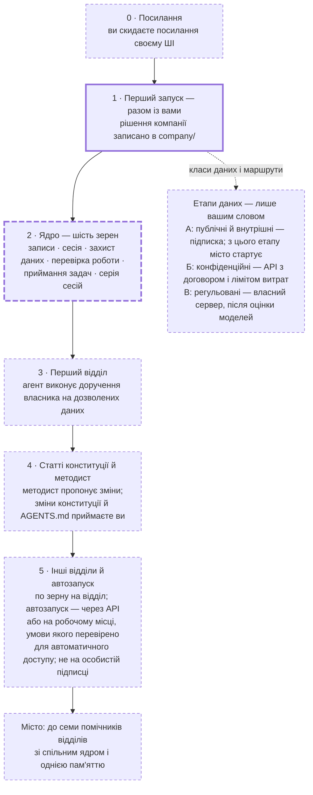

# seeds-for-company-agents-uk — зерна міста агентів для компанії

> Зріз платформи Synoetic™ ([synoetic.org](https://synoetic.org)) — невелика
> частина більшої системи автора, зібрана для компаній: з її словника взято
> кілька слів, решту переказано звичайною мовою. MIT, © Yakiv Kramarenko.

Це не продукт і не готова програма. Це **зерна**: текстові підказки, з яких ваш
ШІ-агент (програма зі штучним інтелектом, що сама виконує доручення) вирощує
помічників для семи відділів звичайної української компанії: юридичного,
фінансового, бази знань, помічника керівника, продажів, відео для соцмереж,
ІТ-розробки. Репозиторій (тека з файлами й історією їхніх змін) загальний:
конкретної компанії в ньому немає. Усе тут — українською; імена файлів —
англійською, латиницею.

## Для кого

Для компанії на десятки чи кілька сотень людей, з відділами, здебільшого
далекими від ІТ, де є людина, готова розібратися з ШІ-помічником (розробник,
адміністратор чи досвідчений користувач). Агент читає `AGENTS.md` (файл з
інструкціями для агента) і далі веде роботу сам. Людина потрібна на першому
запуску, а далі — читати звіти й відповідати на питання агента, поки він
розбудовує **місто агентів**: кілька помічників, які мають одну спільну пам'ять
(сховище файлів компанії) і працюють за спільними правилами.

## Три кроки

1. **Скиньте посилання на цей репозиторій своєму ШІ** — у звичайний чат (Claude,
   ChatGPT) або в інструмент для програмування (Claude Code, Codex) — і скажіть:
   «прочитай `AGENTS.md` і поясни, що мені робити». ШІ розкаже, що зробите ви
   самі (завести приватну копію цих файлів, дати йому до них доступ), а що
   зробить він. Якщо ваш ШІ не відкриває посилання — відкрийте файл `AGENTS.md`
   на цій сторінці й вставте його текст у чат; далі ШІ попросить так само
   вставити `notes/setup.md`.
2. **Коли ШІ скаже, що йому потрібен доступ до файлів**, перейдіть у програму,
   яка працює з файлами на вашому комп'ютері (Claude Code, Codex чи подібна; ШІ
   підкаже, як її встановити), і скажіть: «прочитай `AGENTS.md` і продовж».
   Перший запуск іде разом із вами: агент збирає, що компанія має вирішити, —
   потреби відділів, класи даних (які дані можна показувати ШІ і яким шляхом),
   підписки, стиль текстів — і записує це.
3. **Далі — коротке «продовж» на кожну сесію** (один запуск агента): правила
   агент підхоплює сам — перший запуск це налаштовує; якщо не вийде, агент
   підкаже потрібну фразу. Він читає спільну пам'ять, робить крок, лишає звіт
   простою мовою. Спершу — ядро (базові правила для всіх помічників), потім
   відділи. Коли довіра є, сесії запускають одна одну в межах, які ви задали.

## Шлях: від посилання до міста

Як ці три кроки розгортаються — від першого повідомлення до міста: крок 1 — це
етап 0, крок 2 — етап 1, крок 3 — етапи 2–5: ядро, відділи, автозапуск.
Докладно, з тим, що перевірено, а що ні, — `notes/roadmap.md`.

Товста рамка — перевірено на вигаданій компанії (2026-10-28, тодішня версія
зерен, без живої людини); товста пунктирна — частково (з ядра — лише перше
зерно); тонка пунктирна — ще не перевірено. Пунктирна стрілка — етапи даних
ідуть поруч зі шляхом.

| Етап                                            | Ви                                                                                                                                                                                                                  | Агент                                                                                                                                                                                                                    | Що з'явиться                                                     | Скільки                                               |
| ----------------------------------------------- | ------------------------------------------------------------------------------------------------------------------------------------------------------------------------------------------------------------------- | ------------------------------------------------------------------------------------------------------------------------------------------------------------------------------------------------------------------------ | ---------------------------------------------------------------- | ----------------------------------------------------- |
| 0. Посилання (не перевірено)                    | скидаєте посилання своєму ШІ; заводите приватне сховище                                                                                                                                                             | пояснює, що зробите ви, а що — він                                                                                                                                                                                       | приватна копія зерен у сховищі компанії                          | 1–2 розмови                                           |
| 1. Перший запуск (перевірено, без живої людини) | зібравши у власників відділів задачі й години, відповідаєте про відділи, класи даних, підписки, стиль; затверджуєте порядок відділів                                                                                | записує рішення; забороняє інструменту читати теки закритих класів (так у Claude Code; в іншому інструменті — його спосіб або «не перевірено»; надійніший замок — права доступу — ставить адміністратор); заповнює чергу | `company/*`, теки `data/<клас>/`, черга `AGENDA.md`, звіт        | 1 сесія, разом із вами                                |
| 2. Ядро (частково)                              | кажете «продовж», читаєте звіти                                                                                                                                                                                     | вирощує шість файлів правил ядра                                                                                                                                                                                         | `core/field.md` … `core/run.md`                                  | 6 сесій                                               |
| 3. Перший відділ (не перевірено)                | власник відділу: тиждень обліку «до» (записує задачі й час на кожну); дає задачі там, де відділ працює, — без документів і персональних даних; приймає результат                                                    | правила відділу; виконує доручення власника на дозволених даних                                                                                                                                                          | `departments/<відділ>/AGENTS.md`, результати доручень, показники | тиждень обліку + 1 сесія + серії задач                |
| 4. Статті й методист (не перевірено)            | приймаєте або відхиляєте зміни конституції й `AGENTS.md`; інші зміни бачите у звітах                                                                                                                                | статті конституції (з прикладами промахів, якщо їх записали); методист пропонує зміни                                                                                                                                    | `constitution/articles/`, `core/method.md`                       | 2 сесії, далі методист раз на кілька сесій            |
| 5. Інші відділи й автозапуск (не перевірено)    | власники відділів — як на етапі 3; автозапуск дозволяєте, коли довіряєте тому, як сесії завершуються, — через API або на робочому місці, умови якого перевірено для автоматичного доступу; не на особистій підписці | по зерну на відділ; наглядач, що сам запускає наступну сесію                                                                                                                                                             | правила решти відділів, `core/rehatch.sh`                        | до 6 сесій на відділи + 1 на автозапуск + серії задач |

Сесія — один запуск агента; серія — одна чи кілька сесій поспіль над задачами з
місця задач компанії (спільна тека, трекер чи чат), за вашим сигналом. «Скільки»
пораховано для сесії, що бере одне зерно, як у перевірці на вигаданій компанії;
залежно від підписки сесія може брати більше чи менше (перший запуск, крок 5).
Тривалість у годинах ще не виміряна. Коли місто зупиняється й чекає вас і за
яких умов клас даних переходить на наступний етап — `notes/roadmap.md`.

## Що всередині

- `AGENTS.md` — перший файл для агента: основні правила, межі, що читати коли.
- `AGENDA.md` — черга міста: де зараз робота і що далі.
- `constitution/AXIOMS.md` — конституція (правила, за якими агенти ухвалюють
  рішення): засади (читає кожна сесія) і докладніші аксіоми; статті — пізніше.
- `adrs/` — записи рішень (ADR): що вирішили і чому; `ADR-000` — це місто.
- `seeds/` — перший запуск; дев'ять зерен ядра — шість основних (записи, сесія,
  захист даних, перевірка роботи, приймання задач, кілька сесій поспіль) і три
  пізніші: `letter` (статті конституції), `method` (методист — читає звіти й
  пропонує, як покращити правила), `rehatch` (автозапуск); сім зерен відділів.
- `notes/roadmap.md` — шлях від посилання до міста, етап за етапом.
- `notes/honest.md` — що ми НЕ знаємо й не обіцяємо; `notes/glossary.md` —
  словник і правила простої мови; `notes/setup.md` — технічні кроки для агента;
  `tests/fixture.md` — вигадана компанія для перевірки першого запуску.
- `package.json` та інші службові файли — інструменти автора, вам не потрібні.

## Безпека — коротко

Коли агент читає файл, його вміст уже йде постачальникові моделі ШІ. Тому дані
ділять на класи й кладуть у теки за класами; наповнює їх людина, а в скриньці
задач (тека, куди кладуть прохання) — лише текст прохання: без документів, імен,
телефонів, сум і персональних даних. Кожен клас має маршрут — шлях, яким його
можна давати ШІ: підписка, API (платне підключення за ключем) або власний сервер
(комп'ютер компанії з моделлю). Сесія читає лише те, що допускає її маршрут: це
правила для агента; теки закритих класів додатково закриті в налаштуваннях
інструмента, а повний технічний замок (права доступу на комп'ютері) ставить ваш
адміністратор — `notes/honest.md`. Регульовані дані (персональні, податкова
звітність, зарплатні відомості) — лише на власному сервері з моделлю. Обмежені
(необов'язковий клас: що правила хмарної моделі забороняють) — на вибір із
юристом: власний сервер із моделлю, чия ліцензія це дозволяє; постачальник, чий
договір це допускає (перевірити); окремий договір чи виняток. Одне сховище на
всі відділи — межа першої версії (окремі права — сховище на відділ).

## Хто це підтримує після запуску

Усе працює без автора: створене агентами лежить у вашому сховищі, на ваших
умовах. Ролі: власник від кожного відділу (приймає результат), розробник чи
досвідчений користувач (стежить за контрольними точками — збереженими кроками
роботи — і оновлює зерна), відповідальний за дані (класи, маршрути, доступи).
Неперевірене — `notes/honest.md`.

## Ліцензія

Зерна й решта файлів цього репозиторію — вільні: беріть, змінюйте, користуйтесь
(ліцензія MIT; ім'я автора лишається у файлі `LICENSE`, і те, що ви скопіюєте з
цих файлів слово в слово, — теж лишається під нею). Усе, що виросте у вашій
компанії поверх них (записи в `company/`, відділи, звіти, правила), — ваше, на
будь-яких ваших умовах. Ніщо не зобов'язує вас щось публікувати чи показувати
назовні.
